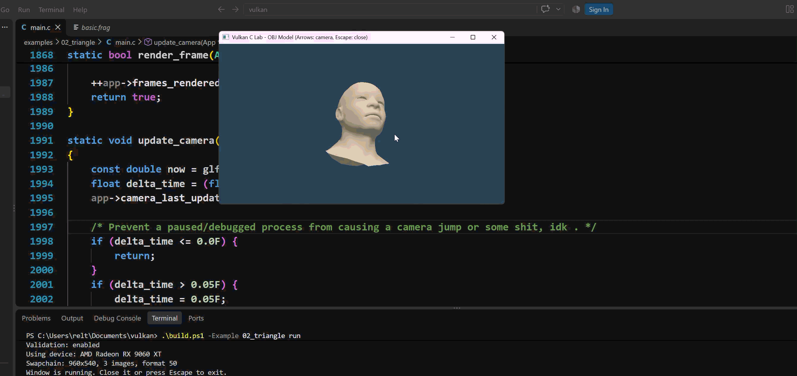

# Vulkan + C

A small C11 project for learning the Vulkan API directly, without a game engine
or C++ abstraction layer. I am still learning Vulkan, so this repository is
work in progress and progress will be slow. The code is written for
understanding first and is not production-ready.



## Examples

| Example | What it demonstrates |
| --- | --- |
| `00_enumerate` | Vulkan instance, validation layers, devices, queues |
| `01_window` | GLFW window, surface, swapchain, synchronization |
| `02_triangle` | OBJ model loading, indexed drawing, depth testing, lighting, orbit camera |

The second example can render another OBJ model:

```powershell
.\build.ps1 -Example 02_triangle -Model assets\models\my_model.obj run
```

## Controls

- Left/right arrow: orbit the camera
- Up/down arrow: tilt the camera
- Escape: close the window

## Requirements

- A C11 compiler
- Vulkan SDK and loader
- GLSL compiler (`glslc`)
- GLFW 3 built with Vulkan support

On Windows, the scripts expect GLFW from vcpkg by default:

```powershell
vcpkg install glfw3:x64-windows
```

## Build and run

Windows PowerShell:

```powershell
.\build.ps1
.\build.ps1 run
.\build.ps1 -Example 02_triangle run
.\build.ps1 -Example 02_triangle check
```

GNU Make:

```bash
make
make run
make EXAMPLE=02_triangle run
make EXAMPLE=02_triangle check
```

Use `check` for a short three-frame smoke test. Shader compilation output and
binaries are written to `build/`.

## Project layout

```text
examples/   Small, separate Vulkan lessons
src/        Shared C helpers
shaders/    GLSL vertex and fragment shaders
assets/     Runtime models
docs/       Learning notes
```

## Current limitations

The model loader supports OBJ geometry and normals. Materials, textures,
animation, glTF, and a full scene system are not implemented yet. The renderer
keeps a single frame in flight so its synchronization stays easy to follow.

The suggested reading order and next topics are in
[`docs/learning-path.md`](docs/learning-path.md).

## Attribution

This README was created with AI assistance. The initial project setup was also
completed with AI assistance because I was not able to set it up myself.
